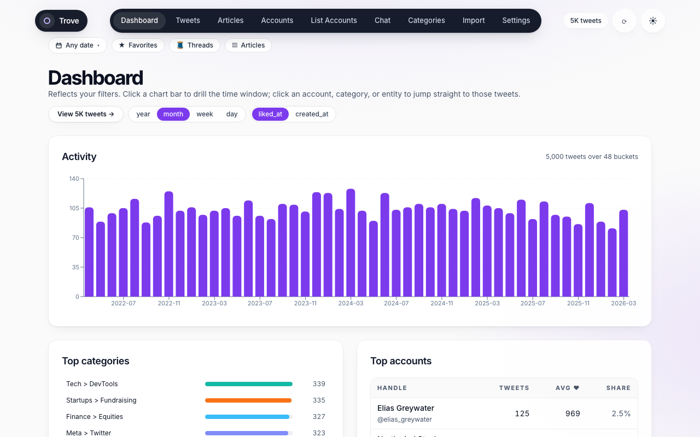
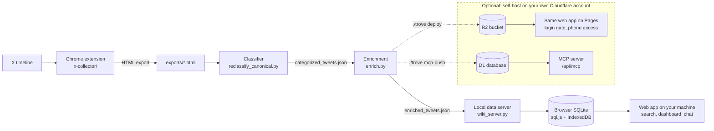
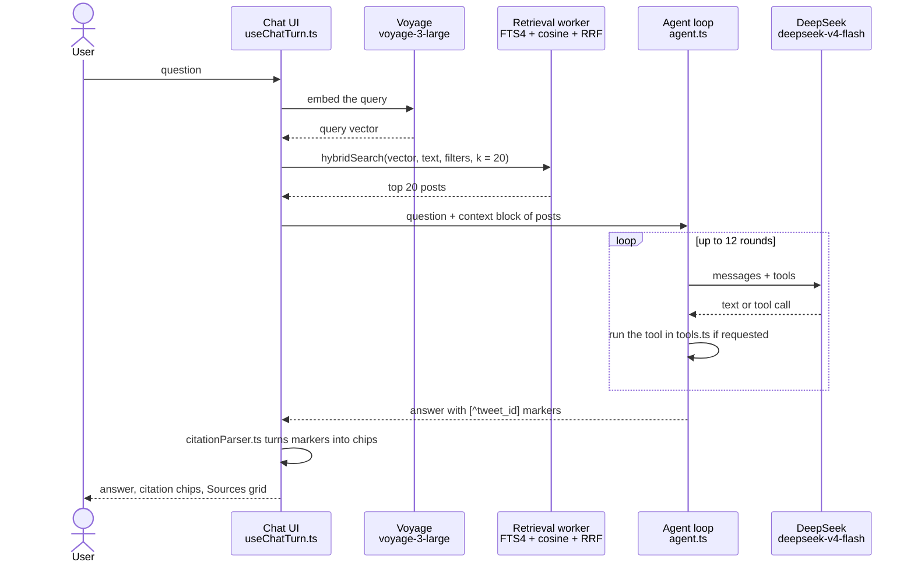
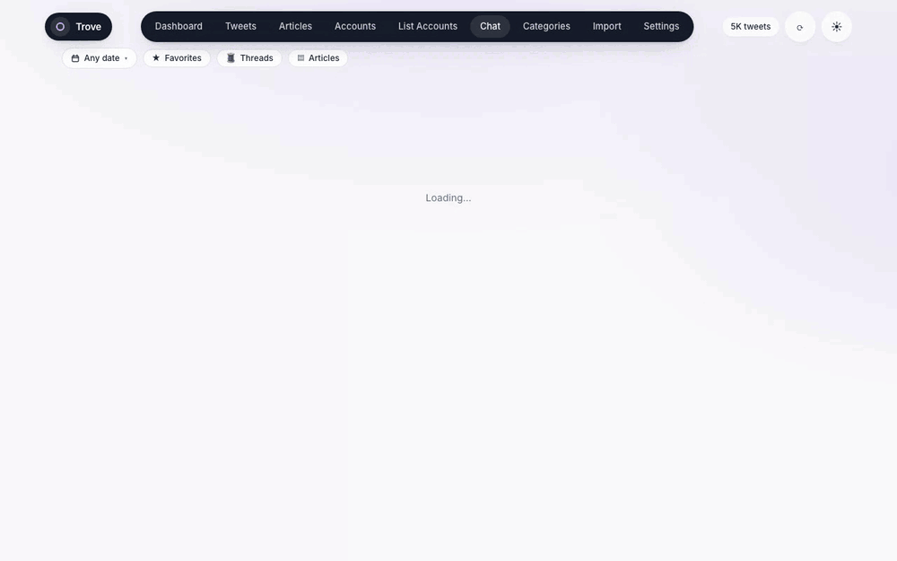
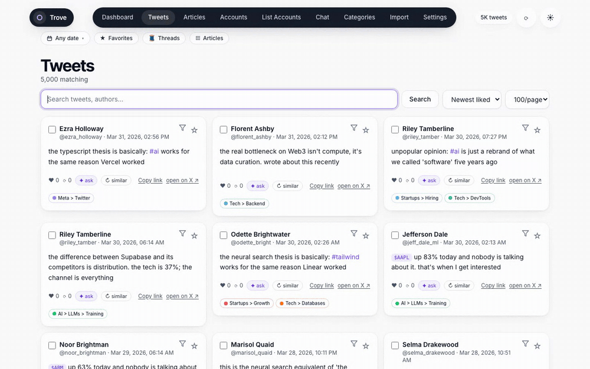
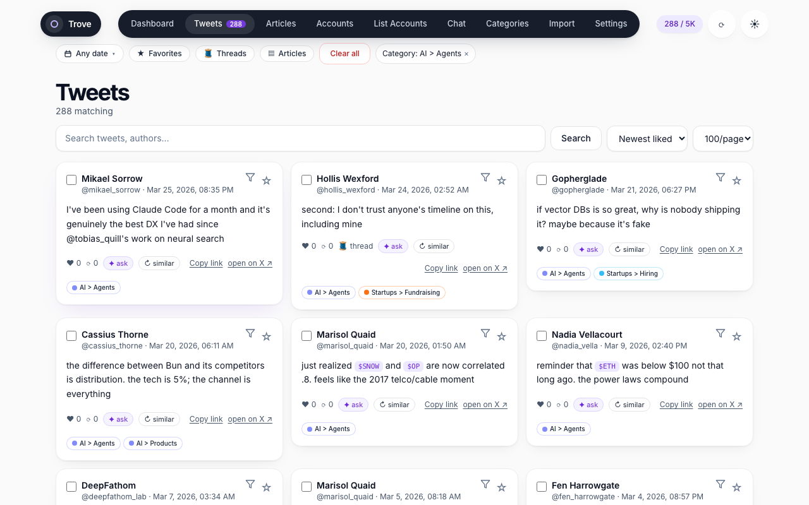
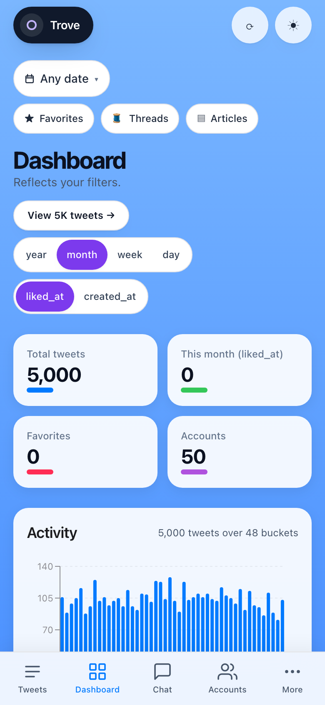
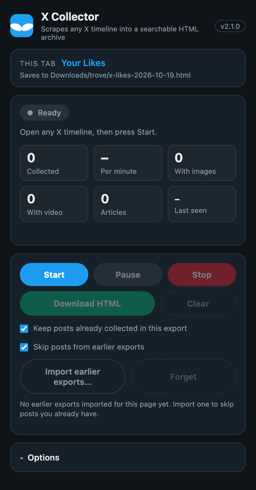

# Trove

Collect X posts from any timeline, search them by meaning, and chat with them.
Trove is a RAG pipeline (retrieval-augmented generation): embeddings, semantic retrieval, and an LLM that answers with citations.



## What it does

- Collects posts from any X timeline with a Chrome extension. Likes, bookmarks, profiles, lists, searches, and more.
- Classifies each post into a fixed taxonomy. Posts with images use the image content.
- Adds the text of linked pages, image descriptions, and Voyage embeddings.
- Stores the whole collection in your browser (SQLite through sql.js, saved to IndexedDB).
- Searches by words (FTS4) and by meaning (cosine similarity over embeddings), fused with Reciprocal Rank Fusion.
- Answers questions in a chat. Each answer cites the source posts and shows them in full.
- Shows charts that filter each other: activity, categories, accounts, tickers, and hashtags.
- Runs on your machine by default, with no Cloudflare account.
- Optional: deploys to your own Cloudflare account for phone access and a remote MCP server for other agents.

## How it works



By default, everything runs on your machine at `http://127.0.0.1:5174`.
You need API keys for the models, but no Cloudflare account.
The dashed box is optional.
Use it only if you want the app on your phone or an MCP server for other agents.
It deploys to your own Cloudflare account, never to anyone else's.

One chat turn works like this.



The last round sends no tools, so the model must write text.
Read [docs/architecture.md](docs/architecture.md) for the details.

## See it

Chat with citations:



Search by words:



| Filters | Mobile | Collector popup |
|---|---|---|
|  |  |  |

All images use a synthetic seed collection of 5,000 invented posts.
No image shows real people or real data.

## Try it without your own data

The repo ships a synthetic collection in `webapp/public/seed/`.

```bash
cd webapp
npm install
npm run dev
```

1. Open `http://127.0.0.1:5174/import`.
2. Drop `public/seed/tweets.html`, `public/seed/classifier.json`, and `public/seed/enriched.json` on the page.
3. Open Dashboard, Tweets, and Categories.
4. For chat, open Settings and paste a DeepSeek key and a Voyage key.

Keys stay in your browser.
Search and charts need no keys.

## Quick start

You need Python 3, Node.js, Chrome or Brave, and API keys.
The keys are OpenRouter (classification and image descriptions), Voyage (embeddings), and DeepSeek (chat).

```bash
git clone https://github.com/fquresh/twitter-trove
cd twitter-trove
cp .env.example .env                 # then add your keys, or run ./trove set-key
(cd webapp && npm install)
python3 -m venv .venv
.venv/bin/pip install -r requirements.txt
```

Then:

1. Load the extension. Open `chrome://extensions/`, turn on Developer mode, click Load unpacked, and select `x-collector/`.
2. Link the download folder to the pipeline input folder: `ln -s ~/Downloads/trove exports`.
   The extension saves to `Downloads/trove/`.
   If `Downloads/trove` does not exist yet, run `mkdir -p ~/Downloads/trove` first.
3. Open an X timeline, click the extension icon, press Start, and press Download HTML when it finishes.
4. Run `./trove go`. It classifies and enriches the new posts, starts the app, and opens the browser.
5. Click the sync button (top right) to load the data.

`./trove go` creates `.venv/` and installs the packages if they are missing.
Run `./trove update --dry` first to see a cost estimate.
Read [docs/getting-started.md](docs/getting-started.md) for the full guide.

## Commands

Run `./trove help` for the list.

| Command | What it does |
|---|---|
| `./trove go [--no-update]` | Update, start the servers, open the browser. Push data to R2 when the cloud is configured. `--no-update` only starts. |
| `./trove start` | Start the web app (port 5174) and the wiki server (port 8765, only if `wiki/` exists). |
| `./trove update [--dry] [--no-images] [--emergent]` | Classify and enrich new posts. `--dry` estimates cost. `--no-images` skips image descriptions. `--emergent` uses the legacy Anthropic classifier. |
| `./trove deploy [--no-update] [--code-only] [--data-only]` | Build and deploy the app to Cloudflare Pages, upload data to R2, verify, and push the MCP index. |
| `./trove mcp-push [--full]` | Rebuild the MCP index in D1. `--full` drops and reloads it. |
| `./trove set-key` | Ask for API keys and write them to `.env`. |
| `./trove wiki` | Start only the wiki server. |
| `./trove stop` | Stop the servers on ports 5174 and 8765. |
| `./trove status` | Show running servers, loaded keys, and cloud settings. |

## Repo map

| Path | Content |
|---|---|
| `trove` | The launcher script. |
| `x-collector/` | Chrome extension that collects X posts. |
| `parse_and_classify.py` | Parses the HTML exports. Legacy emergent classifier. |
| `reclassify_canonical.py` | Default classifier with a fixed taxonomy. |
| `enrich.py` | URL text, image descriptions, and embeddings. |
| `trove_common.py` | Shared cache and batching code. |
| `wiki_bootstrap.py`, `wiki_server.py` | Optional wiki pages and the local data server. |
| `webapp/` | React app, tests, and Cloudflare Pages Functions in `webapp/functions/api/`. |
| `scripts/` | MCP index build, R2 upload, cloud verification, and `capture-media/`. |
| `tests/` | Python unit tests. |
| `docs/` | Guides and media. |
| `exports/` | Your HTML exports. Not tracked by git. |

## Tech stack and models

React 18, Vite 6, strict TypeScript, Tailwind, Zustand, TanStack Query, sql.js, and Recharts.
The optional cloud mode uses Cloudflare Pages, R2, D1, and Access.
The pipeline uses Python with httpx, trafilatura, and numpy.

| Use | Model | Where |
|---|---|---|
| Chat | `deepseek-v4-flash` (any DeepSeek model id works in Settings) | `webapp/src/chat/client.ts`, `webapp/functions/api/chat.ts` |
| Embeddings | `voyage-3-large`, 1024 dimensions, int8 | `enrich.py`, `webapp/src/chat/voyage.ts` |
| Classification | `google/gemini-2.5-flash-lite` through OpenRouter | `reclassify_canonical.py` |
| Image descriptions | `google/gemini-2.5-flash` through OpenRouter | `enrich.py` |
| Legacy classification | `claude-sonnet-4-20250514` | `parse_and_classify.py` |
| Wiki pages | `claude-haiku-4-5` | `wiki_bootstrap.py` |

## Costs

These figures come from the author's own runs on a collection of about 28,000 to 32,000 posts.
Your cost depends on your collection and on current provider prices.

| Run | Cost |
|---|---|
| First full run | About $12. Image descriptions are most of it. |
| Incremental run (78 new posts, 45 new images) | About $0.04. |

Caches stop repeat spending.
Never delete the `.*_cache.json` files.

## Docs

| Guide | Content |
|---|---|
| [Getting started](docs/getting-started.md) | From clone to a working app. |
| [Workflow](docs/workflow.md) | Daily use, commands, and fixes. |
| [Architecture](docs/architecture.md) | Parts, data flow, and models. |
| [Deployment](docs/deployment.md) | Optional: self-host on your own Cloudflare account. |
| [MCP server](docs/mcp-server.md) | Let other agents query your collection. |
| [Wiki schema](docs/wiki-schema.md) | Page format for the optional wiki. |
| [Web app](webapp/README.md) | Web app code map. |
| [Collector](x-collector/README.md) | Extension options and fixes. |
| [Contributing](CONTRIBUTING.md) | Dev setup and tests. |
| [Security](SECURITY.md) | Reporting and security model. |

## Responsible use

Trove is for personal archiving of content that you can already see.
X's terms restrict automated collection.
You are responsible for complying with those terms and with the law.
Collected data stays on your machine.
If you use the optional cloud mode, it also goes to your own Cloudflare account.
Do not redistribute other people's posts.
Never commit `exports/` or `.env` to git.

## Project status

Trove is a personal project. It is shared as-is, with no support and no promise of updates.
The code is released under the [MIT License](LICENSE).
