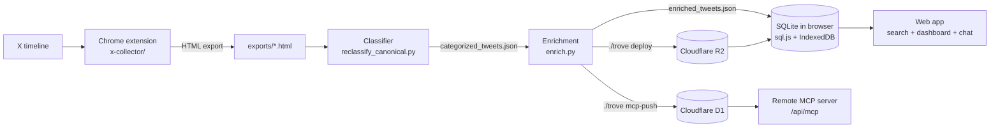
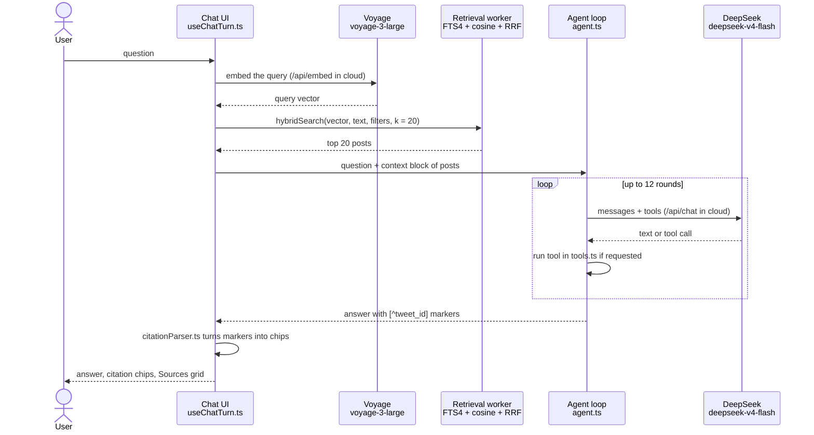

# Architecture

This document explains how Trove works.
Read [getting-started.md](getting-started.md) first if you want to run it.

## Overview

Trove is a RAG system over a personal collection of X posts.
RAG means retrieval-augmented generation.
The system finds the posts that match a question and gives them to a language model.
The model answers and cites the source posts.

The system has six steps: collect, classify, enrich, store, search, and chat.

## The parts

| Part | Path | Job |
|---|---|---|
| Chrome extension | `x-collector/` | Collects posts from any X timeline. Writes one HTML file. |
| Classifier | `reclassify_canonical.py` | Puts each post in a category of a fixed taxonomy. |
| Legacy classifier | `parse_and_classify.py` | Parses HTML exports. Builds free-form categories with `--emergent`. |
| Enrichment | `enrich.py` | Adds URL text, image descriptions, and embeddings. |
| Web app | `webapp/` | Browses, searches, charts, and chats. |
| Wiki server | `wiki_server.py` | Serves wiki pages, the data files, and local keys on `127.0.0.1`. |
| Cloud app | `webapp/functions/` | Runs the same app on Cloudflare. See [deployment.md](deployment.md). |
| MCP server | `webapp/functions/api/mcp.ts` | Lets other agents query the collection. See [mcp-server.md](mcp-server.md). |
| Launcher | `trove` | One Bash command that runs all of the above. |

## Collect

The extension is a Manifest V3 extension in plain JavaScript.
It scrolls an X timeline and records each post.
It supports likes, bookmarks, profiles, lists, communities, topics, searches, hashtags, threads, and quotes.
It also supports home, explore, and notifications.
`x-collector/source.js` names the page type.
The extension refuses follower lists, following lists, and pages with no posts.

The export is one HTML file.
It has an embedded `tweetsData` array with one object per post.
It also has a `collectionMeta` block that names the source page.
The `tweetsData` shape is the contract between the extension and all readers.

## Classify

`reclassify_canonical.py` is the default classifier.
It uses `google/gemini-2.5-flash-lite` through OpenRouter.
The taxonomy is fixed in the file as `CANONICAL_TAXONOMY`.
Posts with images send the image to the model.
The classifier writes `categorized_tweets.json`.

`parse_and_classify.py` is the legacy classifier.
`./trove update --emergent` runs it with `claude-sonnet-4-20250514`.
It builds a free-form category tree.
Both scripts parse the HTML files in `exports/`.

## Enrich

`enrich.py` has three phases.
Each phase runs alone and has its own cache file.

| Phase | Model or tool | Cache |
|---|---|---|
| URL text | `trafilatura` (local, free) | `.url_content_cache.json` |
| Image descriptions | `google/gemini-2.5-flash` through OpenRouter | `.image_description_cache.json` |
| Embeddings | Voyage `voyage-3-large` (1024 dimensions, int8) | `.embedding_cache.json` |

The output is `enriched_tweets.json`.
Caches stop repeat spending.
A rerun with no new posts costs nothing.

## Store

The web app keeps the whole collection in the browser.
It uses sql.js (SQLite compiled to WebAssembly).
The app saves a snapshot to IndexedDB after each change.
The embeddings live in a second database so each snapshot stays small.

The sync button loads the JSON files into SQLite.
Locally, `wiki_server.py` serves the files from disk.
In the cloud, Pages Functions serve them from R2.
Imports are idempotent.
They keep favorites, notes, and manual categories.

## Search and chat

Search combines two retrievers.
SQLite FTS4 finds exact words.
A Web Worker finds posts by cosine similarity over the int8 embeddings.
The app merges both lists with Reciprocal Rank Fusion (k = 60).

One chat turn follows this sequence.

The agent has five SQL tools.
They are `search_tweets`, `count_tweets`, `top_authors`, `tweets_in_period`, and `get_tweet_by_id`.
Three wiki tools load only when the wiki server runs: `list_wiki_pages`, `read_wiki_page`, and `search_wiki`.
The last round sends no tools, so the model must write text.

A citation chip links to the source post in the collection.
The Sources grid shows each cited post in full, with a link to open it on X.

## Local and cloud modes

The same app runs in two places.

| | Local | Cloud |
|---|---|---|
| Command | `./trove go` | `./trove deploy` |
| Address | `127.0.0.1:5174` | Your Cloudflare Pages address, behind Cloudflare Access |
| Data source | `wiki_server.py` reads the disk | Pages Functions read R2 |
| LLM and embeddings | Browser calls DeepSeek and Voyage with local keys | Functions `chat.ts` and `embed.ts` hold the keys |
| Wiki tools | Yes | No |
| Cross-device sync | No | Yes, through D1 (`functions/api/sync.ts`) |

Vite builds the cloud mode when `VITE_USE_API_PROXY=true`.
`webapp/.env.production` sets this value.

## Known caveat: source type is lost on import

The extension writes the source page type in `collectionMeta`.
Neither `parse_and_classify.py` nor `webapp/src/parser/htmlExport.ts` reads `collectionMeta`.
So the pipeline and the app have no field for bookmarks, profiles, or lists.
Every imported post is treated as one kind of saved post, whatever page it came from.

## Models

| Use | Model | Where |
|---|---|---|
| Chat | `deepseek-v4-flash` | Browser or `webapp/functions/api/chat.ts` |
| Query and corpus embeddings | `voyage-3-large` | `enrich.py`, `webapp/src/chat/voyage.ts`, `webapp/functions/api/embed.ts` |
| Classification | `google/gemini-2.5-flash-lite` | `reclassify_canonical.py` |
| Image descriptions | `google/gemini-2.5-flash` | `enrich.py` |
| Legacy classification | `claude-sonnet-4-20250514` | `parse_and_classify.py` with `--emergent` |
| Wiki pages | `claude-haiku-4-5` | `wiki_bootstrap.py` |

## Constraints

- The extension uses no framework and no build step.
- The app uses React 18, Vite 6, strict TypeScript, Tailwind, Zustand, TanStack Query, sql.js, and Recharts.
- The app calls outside services only when you use a feature.
- Never delete the cache files. A deleted cache forces a paid rerun.
- The dev server uses port 5174.
- `wiki_server.py` returns plaintext keys at `/api/keys/load`.
  It accepts only loopback `Host` headers, and its CORS list holds only local ports.

## Privacy

In local mode, your posts stay on your machine.
The app sends data out only when you use a feature.

- X CDN: images.
- DeepSeek: chat questions and the retrieved posts.
- OpenRouter: classification and image descriptions.
- Voyage: embeddings.
- Anthropic: only the legacy classifier and `wiki_bootstrap.py`.

In cloud mode, the data lives in a private R2 bucket in your own account.
Cloudflare Access protects every route.
