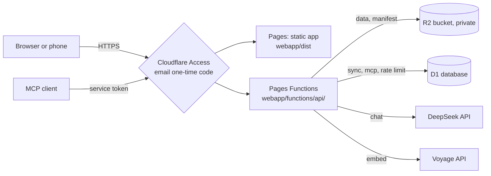

# Deployment

This document describes how to host Trove on your own Cloudflare account.
It contains no account identifiers, secrets, or personal addresses.
Keep those in your Cloudflare dashboard and in `.env`.
Cloud hosting is optional.
The local app works without it.

## Architecture



| Part | Name in this guide | Job |
|---|---|---|
| Pages project | `<your-pages-project>` | Serves the static app and the Functions. |
| R2 bucket | `<your-r2-bucket>` | Stores the data JSON files. Private. |
| D1 database | `<your-d1-database>` | Stores sync data, rate-limit counters, and the MCP search index. |
| Access application | one per Pages project | Gates every route with an email one-time code. |

Check current Cloudflare plan limits before you deploy.

## Functions

The Functions live in `webapp/functions/api/`.

| Function | Route | Job |
|---|---|---|
| `_auth.ts` | (shared) | Verifies the Access token. Fails closed. |
| `_guard.ts` | (shared) | Caps body size, clamps `max_tokens`, rate-limits by user. |
| `chat.ts` | `/api/chat` | Proxies chat to DeepSeek. Holds `DEEPSEEK_API_KEY`. |
| `embed.ts` | `/api/embed` | Proxies embeddings to Voyage. Holds `VOYAGE_API_KEY`. |
| `manifest.ts` | `/api/manifest` | Lists data files and their ETags. |
| `data/[name].ts` | `/api/data/<file>` | Streams a data file from R2. |
| `sync.ts` | `/api/sync` | Syncs favorites, notes, and manual categories. |
| `mcp.ts` | `/api/mcp` | Remote MCP server. See [mcp-server.md](mcp-server.md). |

## Privacy rules

- The R2 bucket has public access off.
  The app never reads R2 directly.
  It reads through `/api/data/<file>`, which checks the Access token first.
- Every route redirects anonymous requests to the Access login.
  This includes per-deployment preview addresses.
- MCP clients send an Access service token in two headers: `CF-Access-Client-Id` and `CF-Access-Client-Secret`.
- `_auth.ts` requires the Access audience value, pins RS256, and fails closed.
  Only local `wrangler pages dev` can disable the check, with `ALLOW_UNAUTHENTICATED_DEV=true`.
- `webapp/public/_headers` sets a strict Content-Security-Policy.

## One-time setup

You need a Cloudflare account and the `wrangler` CLI.

1. Install and sign in: `npm install -g wrangler` and `wrangler login`.
2. Pick three names. Put them in `.env`:
   ```bash
   TROVE_PAGES_PROJECT=<your-pages-project>
   TROVE_R2_BUCKET=<your-r2-bucket>
   TROVE_D1_DB=<your-d1-database>
   TROVE_PAGES_URL=https://<your-pages-url>   # optional; default is https://<TROVE_PAGES_PROJECT>.pages.dev
   ```
3. Create the R2 bucket: `wrangler r2 bucket create <your-r2-bucket>`.
4. Create the D1 database: `wrangler d1 create <your-d1-database>`. Copy the printed database id.
5. Create the config file: `cp webapp/wrangler.example.toml webapp/wrangler.toml`.
   Fill in the project name, bucket name, database name, and database id.
   `webapp/wrangler.toml` is ignored by git.
6. Create the Pages project: `wrangler pages project create <your-pages-project>`.
7. Set the API keys as Pages secrets. Wrangler asks for each value:
   ```bash
   cd webapp
   npx wrangler pages secret put DEEPSEEK_API_KEY --project-name <your-pages-project>
   npx wrangler pages secret put VOYAGE_API_KEY --project-name <your-pages-project>
   ```
8. In Cloudflare Zero Trust, create an Access application that covers the Pages domain and its wildcard.
   Add one policy that allows only your email.
9. Set the Access values as Pages secrets, not in `wrangler.toml`.
   This keeps your email and Access identifiers out of git.
   - `CF_ACCESS_TEAM_DOMAIN`: your Access team domain, for example `<your-team>.cloudflareaccess.com`.
   - `CF_ACCESS_AUD`: the audience tag of the Access application.
   - `ALLOWED_EMAIL`: the one allowed email.

   Use `npx wrangler pages secret put <NAME> --project-name <your-pages-project>` for each one.
   If a value is missing, every `/api/*` call fails closed with a 500 error.
10. Optional: set `VITE_CLOUD_ORIGIN=https://<your-pages-url>` in `webapp/.env.local`.
    The Settings page of a local build then shows your real MCP endpoint.

`webapp/.env.production` sets `VITE_USE_API_PROXY=true`.
Without it, the deployed chat calls the model APIs from the browser and fails.

## Deploy

```bash
./trove deploy
```

The command runs these steps in order.

1. Run the pipeline (same as `./trove update`).
2. Build the app with `npm run build` in `webapp/`.
3. Deploy the bundle with `wrangler pages deploy`.
4. Upload `enriched_tweets.json`, `embeddings.ndjson`, and `categorized_tweets.json` to R2 as gzip, the largest first.
5. Verify the upload with `scripts/verify_cloud_data.py`.
   It reads the data back and compares the post count and the newest date.
6. Push the MCP index to D1 with `./trove mcp-push`.

The deploy ships code before data.
A failed build stops the run before the data upload.
So the cloud never runs new data on an old bundle.

| Flag | Effect |
|---|---|
| `--no-update` | Skip the pipeline. Deploy code and push existing data. |
| `--code-only` | Build and deploy the bundle only. |
| `--data-only` | Push data only. `./trove go` uses this. |

After a deploy, open the cloud app and click the sync button.

## Large uploads

Some networks reset long uploads.
A single request for the large enriched file can then fail.
Use the S3-compatible R2 API with multipart upload instead.

1. In the Cloudflare dashboard, create an R2 API token with Object Read and Write.
   Limit it to your bucket.
2. Run `./trove set-key`.
   Enter `R2_S3_ACCESS_KEY_ID`, `R2_S3_SECRET_ACCESS_KEY`, and `R2_S3_ENDPOINT`.
   The endpoint form is `https://<account_id>.r2.cloudflarestorage.com`.

`./trove deploy` then uses the AWS CLI if it is installed.
Otherwise it uses `scripts/r2_s3_put.py`.

## Verification through the live site (optional)

Without credentials, the deploy verifies only the R2 side.
A service token lets it also test the `/api/data/*` path that browsers use.

1. In Zero Trust, create a service token.
2. Add a Service Auth policy for that token to the Access application.
3. Run `./trove set-key`.
   Enter `CF_ACCESS_CLIENT_ID` and `CF_ACCESS_CLIENT_SECRET`.

`./trove status` shows whether the token is loaded.

## Compressed data

The deploy stores the JSON files as gzip bytes with `Content-Encoding: gzip`.
`webapp/functions/api/data/[name].ts` builds its `Response` with `encodeBody: 'manual'`.
The default setting compresses the body a second time, and the browser then fails with "invalid JSON".
`webapp/src/tests/functionsProxy.test.ts` guards this rule.

## Cross-device sync

Favorites, notes, and manual category assignments sync through `/api/sync`.
Each device writes changes to a local outbox.
The server merges them with last-write-wins.
The server assigns a sequence number to each change, so a late write is never skipped.
The `mutations` table creates itself on the first request.
Sync works in the cloud app only.

## Phone install

1. Open the Pages address in Safari on the phone.
2. Sign in with the email code.
3. Tap Share, then Add to Home Screen.

If the code fails with "already used", your mail client may open the login link first.
Type the code at once and do not tap the link.

## Limits

- The cloud app has no wiki tools.
- Remote MCP search uses keywords only, not vectors.
- Gzip shrinks the enriched file only a little, because embeddings do not compress well.

## Rotating tokens

Create Cloudflare API tokens with a short life.
Revoke or rotate them in the Cloudflare dashboard under API Tokens.
